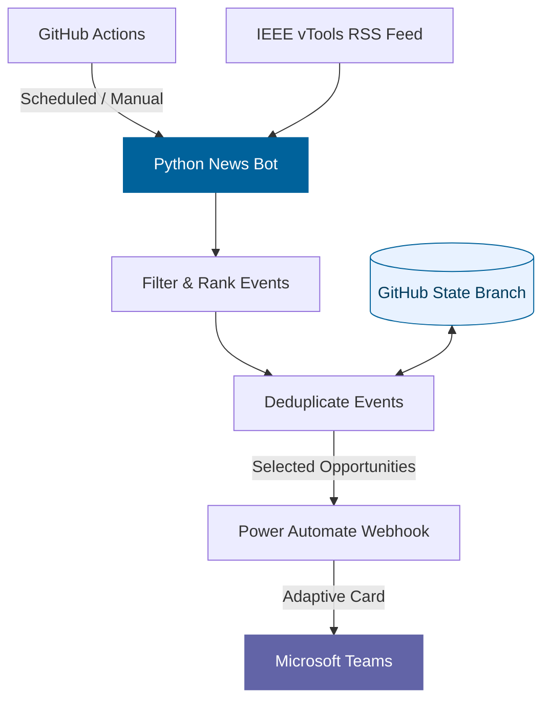
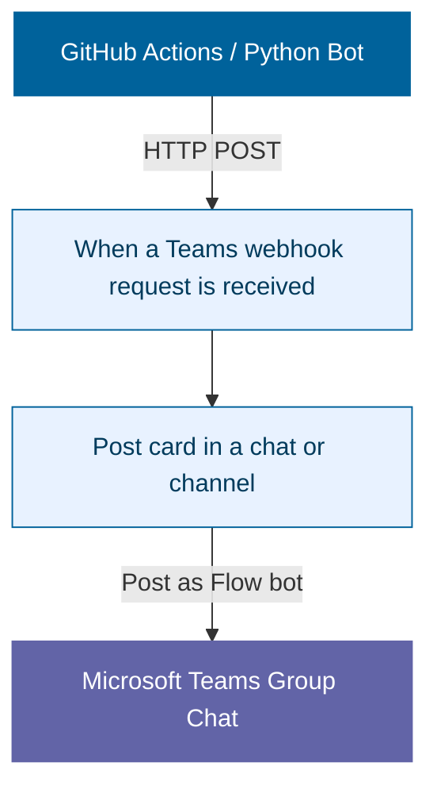

<div align="center">

# IEEE AUBH News Bot

### Automated IEEE Opportunities Digest for Microsoft Teams

A Python-based automation system that discovers, filters, and shares relevant IEEE events and opportunities with the IEEE AUBH community.


</div>

---

## Overview

The **IEEE AUBH News Bot** automates the discovery and distribution of upcoming IEEE opportunities using official IEEE vTools event listings.

Instead of manually searching for events, the bot filters and ranks relevant opportunities before delivering a curated digest directly to a Microsoft Teams group chat.

### Key Features

- **Automated Discovery:** Retrieves upcoming events from IEEE vTools.
- **Smart Filtering:** Excludes expired, cancelled, private, and irrelevant events.
- **Opportunity Ranking:** Prioritizes relevant events and opportunities.
- **Scheduled Delivery:** Runs every Sunday and Wednesday.
- **Microsoft Teams Integration:** Publishes up to five opportunities in one Adaptive Card.
- **Duplicate Prevention:** Tracks previously announced events across runs.
- **Safe Testing:** Supports dry runs without sending messages.

## System Architecture

The bot combines Python-based event processing, GitHub Actions automation, persistent state management, and Microsoft Teams delivery.



### Screenshot of power automate flow


### How It Works

1. **Trigger:** GitHub Actions starts the bot automatically or through a manual run.
2. **Collect:** Python retrieves upcoming events from the official IEEE vTools RSS feed.
3. **Filter:** Events are evaluated based on relevance, dates, and accessibility.
4. **Deduplicate:** Previously announced opportunities are excluded using persistent GitHub state.
5. **Publish:** A single Adaptive Card containing up to five opportunities is delivered through Power Automate to Microsoft Teams.

## Power Automate Integration

Power Automate acts as the connection between the Python bot and Microsoft Teams.

The existing workflow receives an HTTP request containing the Adaptive Card payload and posts the card to the configured Teams group chat.



The workflow contains two main components:

- **Webhook Trigger:** Receives the event digest from the Python application.
- **Teams Action:** Posts the Adaptive Card as Flow bot to the selected group chat.

The destination chat is managed within Power Automate and can be changed without modifying the Python application.

<!-- Optional: Add a screenshot of the actual Power Automate flow.

-->

## Automation Schedule

The bot runs automatically twice a week.

| Day | Bahrain Time | UTC |
|---|---|---|
| Sunday | 10:00 AM | 07:00 |
| Wednesday | 10:00 AM | 07:00 |

The schedule is configured in `.github/workflows/digest.yml`:

```yaml
schedule:
  - cron: "0 7 * * 0,3"
```

GitHub Actions uses UTC. Scheduled executions may occasionally be delayed.

## Getting Started

### Prerequisites

- Python 3.12
- Git
- Microsoft Teams
- Power Automate webhook

### Installation

Clone the repository:

```bash
git clone https://github.com/ZainMayoof/ieee-aubh-news-bot.git
cd ieee-aubh-news-bot
```

Create and activate a virtual environment using Windows PowerShell:

```powershell
py -3.12 -m venv .venv
.\.venv\Scripts\Activate.ps1
```

Install the required dependencies:

```powershell
python -m pip install --upgrade pip
pip install -r requirements.txt
```

Run the automated tests:

```powershell
python -m pytest -q
```

Run a dry test:

```powershell
python main.py --dry-run --state-file state/posted_events.json
```

Dry runs do not send Teams messages or modify persistent published-event state.

## GitHub Actions Configuration

The bot uses GitHub Actions for scheduling, execution, and persistent state management.

### Repository Secret

Navigate to:

**Settings → Secrets and variables → Actions**

Create the following secret:

| Secret | Description |
|---|---|
| `TEAMS_WEBHOOK_URL` | Power Automate webhook endpoint |

The webhook URL must remain private and should never be committed to the repository.

### Manual Execution

Navigate to:

**Actions → IEEE AUBH Opportunities Digest → Run workflow**

Choose the appropriate settings:

| Setting | Dry Run | Live Send |
|---|---|---|
| `dry_run` | `true` | `false` |
| `send_to_teams` | `false` | `true` |

A live send requires a valid webhook secret and the appropriate environment settings.

## Duplicate Prevention

To prevent repeated announcements, the bot maintains a dedicated GitHub branch named `digest-state`.

```text
digest-state
└── state
    └── posted_events.json
```

Before a live announcement, selected event IDs are reserved and saved to the state branch.

After a successful webhook response, the bot finalizes the published event IDs.

This ensures that previously recorded opportunities are excluded from future runs, including across Sunday and Wednesday digests.

### Reliability and Safety

- Dry runs never post to Teams or update published state.
- Live sending requires explicit authorization.
- Empty digests are not published.
- Event IDs are reserved before live delivery to reduce duplicate announcements.
- Failed reservations prevent posting.
- GitHub Actions concurrency prevents overlapping executions.
- Webhook credentials are stored securely in GitHub Actions secrets.
- The bot exits safely when state cannot be accessed or updated.

<details>
<summary><b>Technical Details: State Management</b></summary>

The workflow maintains published-event state on the dedicated `digest-state` branch rather than relying on temporary GitHub Actions runner storage.

- Fetches the remote state branch into a detached Git worktree.
- Reads and updates `.digest-state/state/posted_events.json`.
- Reserves selected event IDs before sending.
- Pushes the reservation before attempting the webhook request.
- Finalizes published IDs following a successful webhook response.
- Retains reserved IDs after failures to reduce duplicate delivery.
- Uses the concurrency group `ieee-aubh-digest` with `cancel-in-progress: false`.

If the state cannot be safely updated, the workflow does not attempt a live post.

A successful webhook HTTP response does not independently confirm that the Adaptive Card appeared in Teams. Delivery can be verified through Power Automate run history.

</details>

<details>
<summary><b>Technical Details: Event Sources and Filtering</b></summary>

The bot retrieves public IEEE events from the official IEEE vTools RSS feed:

```text
https://events.vtools.ieee.org/RST/events/api/public/v8/events/list.rss?span=now~now%2B30.days&published=true&limit=100
```

The feed is currently the only enabled event source.

The filtering process excludes:

- Expired events or events with uncertain dates
- Cancelled or postponed events
- Private or invitation-only meetings
- Internal administrative events
- Irrelevant social activities
- Events with unverified accessibility

Event descriptions are normalized using BeautifulSoup, and dates are extracted from structured event metadata or recognizable text.

The bot sends fewer than five opportunities when fewer qualifying events are available.

</details>

<details>
<summary><b>Technical Details: Live Testing</b></summary>

Live sending requires:

- `DRY_RUN=false`
- `SEND_TO_TEAMS=true`
- A valid `TEAMS_WEBHOOK_URL`

Example using Windows PowerShell:

```powershell
$env:DRY_RUN = "false"
$env:SEND_TO_TEAMS = "true"
$env:TEAMS_WEBHOOK_URL = "YOUR_WEBHOOK_URL"

python main.py --send --state-file state/posted_events.json
```

After testing, clear the environment variables:

```powershell
Remove-Item Env:TEAMS_WEBHOOK_URL
Remove-Item Env:SEND_TO_TEAMS
$env:DRY_RUN = "true"
```

Confirm the destination chat in Power Automate before performing a live test.

</details>

<details>
<summary><b>Technical Details: Security</b></summary>

The GitHub Actions workflow requires `contents: write` permission to maintain the dedicated state branch.

Security recommendations:

- Protect the `main` branch from unintended changes.
- Never commit `.env` files or webhook credentials.
- Restrict access to repository secrets.
- Rotate the webhook URL if it becomes exposed.
- Avoid printing sensitive webhook parameters in logs.
- Verify Power Automate delivery through workflow run history.

</details>


## Technology Stack

| Technology | Purpose |
|---|---|
| Python 3.12 | Core application and event processing |
| IEEE vTools RSS | Official event source |
| BeautifulSoup | HTML parsing and cleaning |
| GitHub Actions | Scheduling and automation |
| GitHub State Branch | Persistent event tracking |
| Power Automate | Webhook integration |
| Microsoft Teams | Opportunity announcements |
| Adaptive Cards | Structured digest presentation |

---

<div align="center">


**Developed by [Zain Mayoof](https://github.com/ZainMayoof)**

</div>
